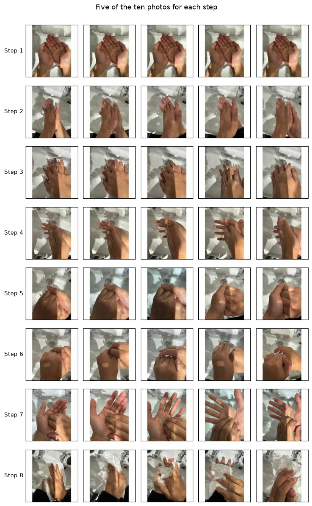
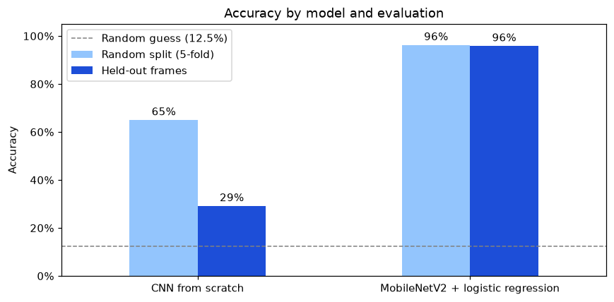
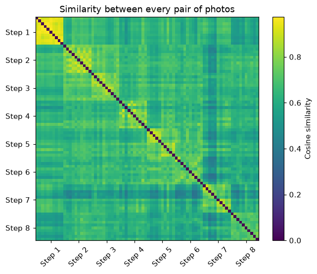

# Hand-washing step recognition

[](https://github.com/muntaka-mahdin/hand-washing-steps/actions/workflows/notebook.yml)

Image classifiers that recognise which of eight hand-washing steps is being done in a photo, trained on a small dataset I photographed and labelled myself. It compares a CNN trained from scratch with transfer learning, and shows how much the way you split a small dataset changes the result.

**[Open the notebook](hand_washing_steps.ipynb)** to see the full analysis with code and charts.

> **About this version.** This started as coursework for the Data-Driven Artificial Intelligence module in my final year at the University of Huddersfield (2024–25), where I built a TensorFlow CNN on this dataset. The original notebook didn't survive, but I still had the photos, so in November 2026 I rebuilt the project from them. Everything here, code and results, is from the rebuild.



## Results

Accuracy on 8 steps, where guessing at random would score 12.5%:

| Model | Random split (5-fold) | Held-out frames |
|---|---|---|
| CNN trained from scratch | 65% | 29% |
| **MobileNetV2 features + logistic regression** | **96%** | **96%** |



- **The CNN trained from scratch mostly memorised the shots.** It looks passable when photos are split at random, but drops to 29% when tested on photos taken after its training photos. 70 photos aren't enough to learn visual features from nothing.
- **Transfer learning holds up.** Reusing the features of MobileNetV2, pretrained on ImageNet, gives 96% on both evaluations, with 23 of the 24 held-out photos right. It also trains in under a second.

## Why the split matters

Each step was photographed in one burst, so the 10 photos of a step are near-copies of each other. 98% of photos have their closest match in the same step.



A random split puts near-copies of each test photo in the training set, so it partly tests whether a model can recognise the same shot again. So I also test on **held-out frames**: train on the first 7 photos of each step and test on the last 3. The gap between the two columns above shows that the from-scratch CNN was relying on those near-copies, while the transfer-learning model wasn't.

## Limitations

These results don't show how well it would work for other people. Every photo has the same hands, sink, light and session. A real system would need photos from many people and places and should be tested on people it has never seen. Hand-washing is also a motion, so short video clips would suit it better than single frames.

## Method

1. **Data:** 80 photos at 150×150 pixels, 10 per step, in `data/step_1` to `data/step_8`.
2. **Similarity check:** each photo is described with MobileNetV2's pretrained features, then every pair is compared with cosine similarity.
3. **Model 1:** a four-layer CNN in Keras with data augmentation (flips, small rotations, zoom and contrast), trained from scratch.
4. **Model 2:** frozen MobileNetV2 features (160×160 input) with a logistic regression classifier.
5. **Evaluation:** stratified 5-fold cross-validation, and a held-out-frames split; then a confusion matrix and the misclassified photos.

## Run it locally

You need Python 3.11 or newer.

```bash
python -m venv .venv
.venv\Scripts\activate          # Windows (on macOS/Linux: source .venv/bin/activate)
pip install -r requirements.txt
jupyter notebook hand_washing_steps.ipynb
```

The notebook's cells are generated from `build_notebook.py`. After changing it, rebuild and re-run:

```bash
python build_notebook.py
jupyter nbconvert --to notebook --execute --inplace hand_washing_steps.ipynb
```

The first run downloads the MobileNetV2 weights (about 9 MB).

## Data and licences

The photos in `data/` are my own and are shared for this project. The code is MIT licensed. MobileNetV2's pretrained weights come from Keras Applications.

## Author

**Muntaka Mahdin** · [GitHub](https://github.com/muntaka-mahdin) · [LinkedIn](https://www.linkedin.com/in/muntaka-mahdin-2a80b8233/)

More of my projects: [Crime Lens](https://github.com/muntaka-mahdin/crime-lens) · [Hotel cancellation prediction](https://github.com/muntaka-mahdin/hotel-cancellation-prediction) · [Pet Activity Tracker](https://github.com/muntaka-mahdin/pet-activity-tracker) · [Card-G](https://github.com/muntaka-mahdin/card-g)
